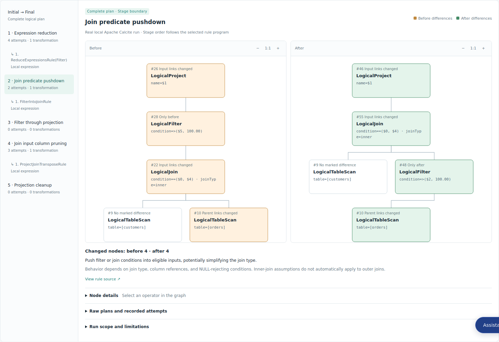
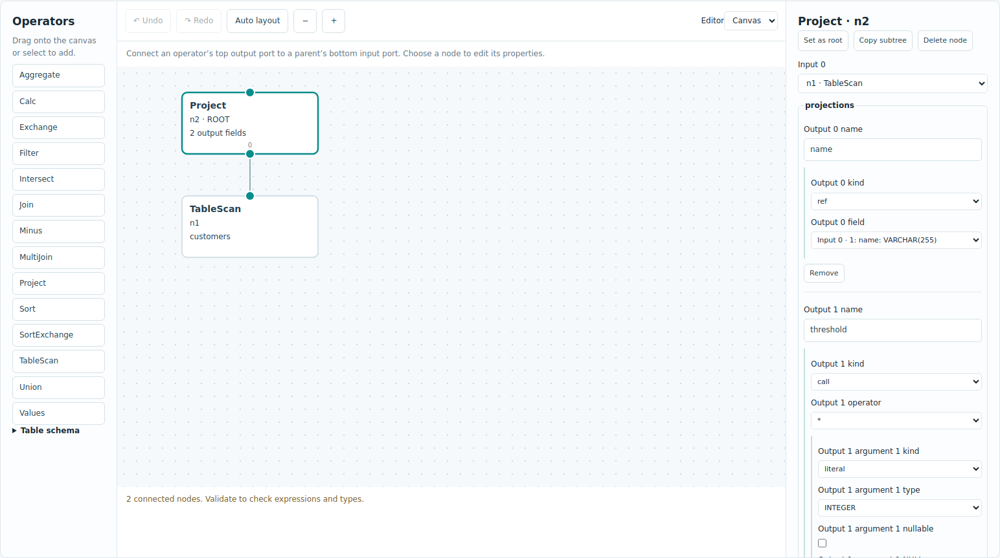
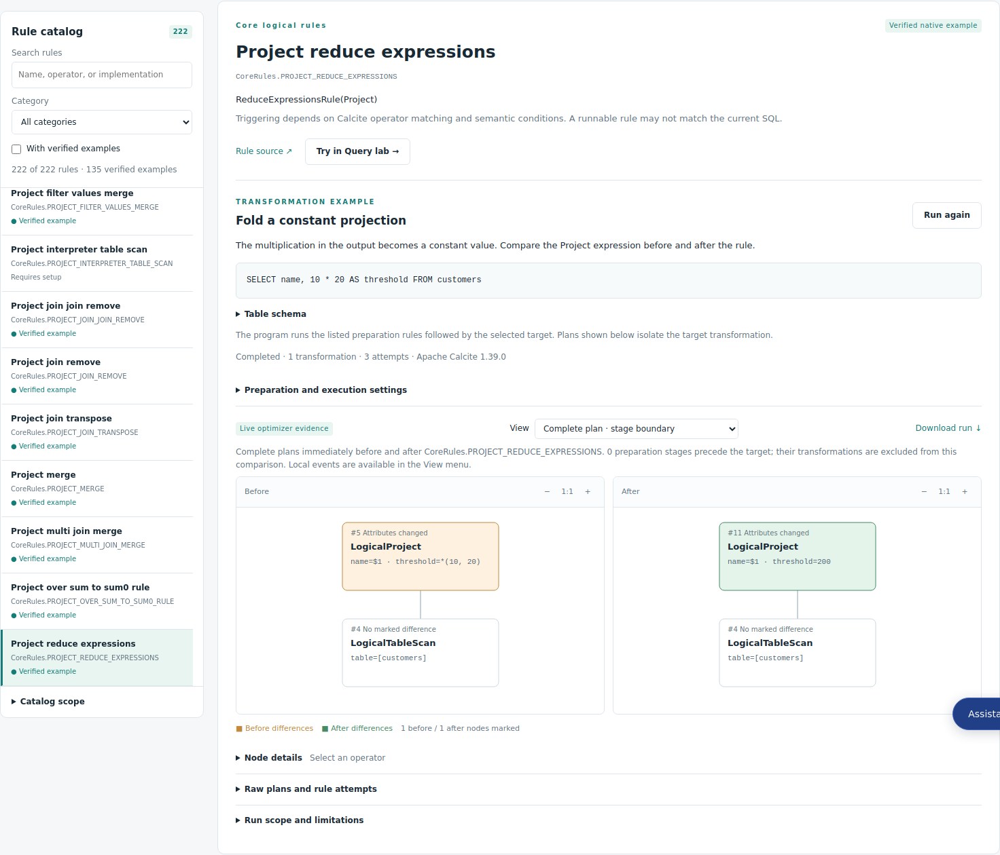

# OptiLens

See every step of SQL optimization.

OptiLens is a local web tool for exploring database optimizer rules. Write SQL or build a logical plan, apply real rules, and inspect how the plan changes. Use it to study optimizer behavior, understand rule conditions, and reproduce small experiments.

- **Query Lab** — edit SQL and table schemas, choose rules, and compare plans.
- **Plan Lab** — build logical operator trees with a visual editor and structured expressions.
- **Rule Explorer** — browse rules and run verified before/after examples.
- **Assistant** — optionally ask questions about plans, rules, and pinned optimizer source code.

Apache Calcite **1.39.0** is bundled. StarRocks **4.0.14** is available through an optional native adapter. OptiLens compiles and optimizes queries; it does not execute them or measure query performance.

## Quick start

Requires **JDK 17+** and **Maven 3.8+**. The first build downloads dependencies.

```bash
git clone https://github.com/weiqxu/OptiLens.git
cd OptiLens
mvn package
java -jar target/optilens.jar
```

Open [http://127.0.0.1:8080](http://127.0.0.1:8080). The web interface is bundled in the JAR, so no separate frontend server or Node.js installation is needed.

To choose another port or record directory:

```bash
OPTILENS_PORT=8081 OPTILENS_DATA_DIR=./data/runs java -jar target/optilens.jar
```

The service listens on the local machine. Local port forwarding is supported. Run history is saved in `data/runs/` by default; stop the service before backing up that directory.

## Query Lab: explore a SQL rewrite

1. Choose a database and a built-in example, or enter your own SQL and table schema.
2. Search for rules and add them in the order you want to apply them.
3. Click **Run optimization**.
4. Compare the initial and final plans, then select a stage or individual rule event to inspect its before/after trees. Click a node to view its details.



Rules may require particular plan shapes or metadata. Selecting a rule does not guarantee it will match. A generated candidate is evidence of a transformation, not proof of better performance.

## Plan Lab: build a plan by hand

Open **Plan Lab**, drag operators onto the canvas, connect their inputs, and edit their properties in the inspector. Join inputs distinguish left and right sides.

Choose the root and rule program, then click **Validate & preview** and **Run rules**. You can target the whole tree or one subtree, switch between canvas and JSON, copy subtrees, undo/redo edits, and import/export a draft.



Results leave the original draft intact. **Use result as input** starts another experiment when the result can be represented without losing information. Unsupported result structures remain available for read-only inspection.

## Rule Explorer: learn from an example

Open **Rule Explorer**, choose a database, and search the rule list. Select a rule with a verified example to run it and inspect the actual transformation. Use **Try in Query lab** or **Try in Plan Lab** to edit the example and experiment further.



Some rules require preparation stages, adapter configuration, or specialized metadata. The explorer shows these requirements and identifies rules that do not yet have a verified example.

## Assistant

Open **Assistant** in any Lab or the Rule Explorer to ask about the current input, a selected node, or a rule. Answers stream into the panel. Verified source citations identify fixed-version files and lines; node references link back to the corresponding plan.

Configure a compatible Chat Completions service before starting OptiLens:

```bash
export OPTILENS_ASSISTANT_ENDPOINT="https://your-provider.example/v1/chat/completions"
export OPTILENS_ASSISTANT_MODEL="your-model"
read -rsp 'API key: ' OPTILENS_ASSISTANT_API_KEY; echo
export OPTILENS_ASSISTANT_API_KEY
java -jar target/optilens.jar
```

The optimizer works without a model. Keys stay on the server. Review suggestions before applying them, then run the optimizer to verify their effect. See [Assistant setup](plan/assistant.md) for configuration and supported capabilities.

## StarRocks

Calcite works out of the box. To run StarRocks experiments, install the pinned runtime and build its adapter by following the [StarRocks setup guide](plan/starrocks.md). Set `OPTILENS_STARROCKS_HOME` before starting the service, then select **StarRocks** in the database menu.

## Save and share experiments

Use the result download action to export a run as JSON. Import a saved run to inspect it or rerun its input. Imported results are marked as unverified until re-executed locally. Plan Lab also supports importing and exporting editable drafts.

For API details, schema format, resource limits, and development checks, see the [reference](plan/development.md).

## License

OptiLens is licensed under the [Apache License, Version 2.0](LICENSE).
