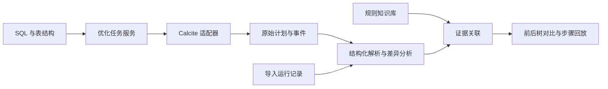

# OptiLens 设计与实施计划

状态：待实现

更新时间：2026-10-20

## 1. 项目目标

构建一个研究数据库查询优化规则的服务，结合源码、计划与运行证据，回答以下问题：

1. 某个数据库版本实现了哪些优化，适用条件是什么？
2. 对一条具体 SQL，优化器尝试或应用了哪些规则？
3. 每次变换改变了哪些算子、表达式、属性或连接关系？
4. 规则生成的候选是否进入最终计划？
5. 不同数据库在相同案例上的优化行为有哪些异同？

核心观察对象是逻辑计划、关系表达式及物理计划。SQL AST 可作为补充视图，但不将所有优化解释为 SQL 语法树改写。

## 2. 输入和结论边界

| 输入 | 可提供的证据 | 不能单独确认的结论 |
| --- | --- | --- |
| 源码及测试 | 规则实现、匹配模式、适用条件、测试覆盖 | 某条 SQL 实际触发了规则 |
| 一份执行计划 | 输出算子、表达式、连接顺序及估算信息 | 完整的中间变换历史 |
| 两份执行计划 | 结构和属性差异 | 差异由哪一条规则独立造成 |
| 优化 trace 或插桩 | 已采集的规则事件、输入和输出表达式 | 未被记录的拒绝原因或搜索过程 |
| 开关对照实验 | 某项配置变化后的计划及性能差异 | 每条内部规则的独立因果贡献 |

界面应区分“运行事件确认”“计划差异观察”“源码解释”“推断”和“演示数据”。不使用没有依据的置信度百分数。

## 3. 首版范围

首版以 Calcite 为唯一执行与采集后端，优先使用 HepPlanner 和显式规则集合，完成可复现的逻辑优化闭环。

### 必须实现

- 输入 SELECT SQL 和声明式表结构；提供内置案例，降低使用门槛。
- 解析、校验 SQL，并生成初始逻辑计划。
- 按已配置的规则程序运行优化，记录真实事件与计划数据。
- 展示初始计划、相关变换步骤及最终逻辑计划。
- 对选中步骤展示前后关系表达式或计划快照，突出差异。
- 点击算子查看表达式、输入输出及可获得的属性。
- 展示规则说明、适用条件与对应证据。
- 导出可重新导入的运行记录，支持离线复查。
- 标注引擎版本、配置、数据来源和缺失的信息。

### 暂不纳入首版

- 自动理解任意数据库的全部源码和规则。
- 从一份 EXPLAIN 结果完整恢复优化历史。
- 查询执行及性能基准测试。
- 完整的 Volcano/Cascades 搜索空间回放。
- 多数据库在线连接、团队权限和托管部署。

首版结果表示逻辑优化行为，不宣称已经测得执行性能收益。

## 4. 服务架构



建议分为四个职责清晰的模块：

| 模块 | 职责 |
| --- | --- |
| 任务服务 | 输入校验、任务生命周期、超时、结果存取与导出 |
| 引擎适配器 | 解析与优化、采集原始事件、声明支持的能力 |
| 分析层 | 统一展示表示、差异计算、规则与证据关联 |
| 前端 | 步骤选择、树与图展示、节点详情、原始证据查看 |

源码分析是后续独立模块；先手工维护经核查的少量规则卡片。

### 初步技术选择

- 后端：Java + Apache Calcite；服务框架在技术验证后确定。
- 前端：TypeScript；建议评估 React 与支持有向图布局的组件库。
- 数据保存：首版可使用本地运行目录和 JSON，无需先引入数据库。
- 依赖版本：技术验证时固定版本，记录在构建配置和运行结果中。

以上为设计建议，不是已经完成的技术选型或现有仓库结构。

## 5. Calcite 采集设计

使用 RelOptListener 监听规则尝试、表达式产生、等价关系及最终选择事件。RuleMatchVisualizer 可作为技术验证工具和参考实现；自有适配器负责输出 OptiLens 的版本化数据格式。

需要在技术验证阶段确认：

- HepPlanner 各类事件的顺序、内容及规则调用标识。
- 成功事件前后回调的配对方式，避免重复计为两次变换。
- 局部输入输出表达式与完整计划之间的关系。
- 初始计划、阶段边界及最终计划的快照采集点。
- 表达式复用、包装节点及节点标识随阶段变化的行为。

不能把事件提供的局部表达式直接宣称为完整全局计划。若某一步仅能可靠采集局部输入输出，就展示“局部变换”；完整计划只在已验证的采集点展示。

首版可按明确阶段运行选定规则并采集阶段快照，但必须区分“阶段前后变化”和“单次规则事件”。不把拆分后的受控实验冒充引擎默认优化流程。

快照必须保存当时的数据，避免保留可变对象引用导致历史结果被覆盖。

## 6. 核心数据模型

### OptimizationRun：一次优化运行

- 运行 ID、记录格式版本、创建时间及状态。
- 引擎名称、版本与可获得的源码提交标识。
- SQL、表结构、可用统计信息及优化配置。
- 规则程序、执行顺序和停止条件。
- 初始快照、最终快照、事件序列及原始数据位置。
- 采集能力与缺失信息说明。

### PlanSnapshot：计划或表达式快照

- 快照 ID、阶段、范围：完整计划或局部表达式。
- 根节点、节点集合、输入边及输入顺序。
- 原生算子类型与统一展示类型。
- 表达式、输出列、连接类型和其他引擎属性。
- 可获得的估计行数、cost 及其来源；缺失时保持为空。
- 原始引擎输出。

模型允许节点共享和有向无环图；后续扩展等价集合及物理属性，不仅保存嵌套树。

### RuleEvent：规则相关事件

- 事件序号、事件类型、规则标识及调用标识。
- 输入与输出表达式、关联快照、匹配节点。
- 状态：尝试、产生结果、发现等价关系等。
- 引擎明确提供的原因或附加信息。
- 证据来源和原始记录引用。

不将“事件中未给出拒绝理由”改写为“规则不适用”。最终选择信息与变换事件分别保存；无法可靠关联时，最终采用状态为未知。

### RuleCard：规则知识卡片

- 规则名称、引擎、版本范围和概念分类。
- 源码文件、符号及固定提交链接。
- 匹配模式、适用条件与语义限制。
- 变换说明、示例 SQL 和关联测试。
- 信息来源及核查状态。

规则概念与引擎实现允许多对多关联，避免假设不同数据库存在一一对应的规则。

## 7. 差异分析

优先使用同一运行中的可靠节点标识和事件关系；缺少标识时，结合算子类型、表达式、输入结构和列来源进行匹配。

显示以下差异：

- 节点新增或删除。
- 节点移动和输入边变化。
- 表达式变化，例如常量折叠。
- 输出列及物理属性变化。

匹配不唯一时保留歧义，避免把两个相似子树强行判为同一节点。规范化应保留 NULL、类型、排序、连接语义及重复行语义；不要为让图形一致而丢掉这些信息。

跨运行、跨数据库的差异只能先描述观察到的变化。规则归因需要额外事件或源码证据。

## 8. 图形界面

默认采用双树对比布局：

```text
SQL、表结构与运行配置
┌────────────┬───────────────────┬───────────────────┐
│ 规则步骤   │ 应用前计划/表达式 │ 应用后计划/表达式 │
│            │                   │                   │
│ 常量折叠   │ 节点与输入连线    │ 高亮变化节点      │
│ 谓词下推   │                   │                   │
│ 列裁剪     │                   │                   │
├────────────┴───────────────────┴───────────────────┤
│ 变化说明、适用条件、证据类型、节点详情与源码链接   │
└───────────────────────────────────────────────────┘
```

- 切换步骤后同时更新前后树和说明。
- 差异使用颜色与文字双重标识，不能只依赖颜色。
- 点击节点查看完整表达式、输出列和原始属性。
- 保持可对应节点的布局尽量稳定，减少视觉跳动。
- 大计划支持缩放、定位和子树折叠；窄屏改为上下对比。
- 初始与最终状态明确标识，局部事件单独标注范围。
- 后续增加等价候选图，以表达成本优化器的搜索过程。

已有交互讨论稿只用于说明布局和交互，不作为真实规则行为的证据。

## 9. 分阶段实施与验收

### M0：采集技术验证

- [ ] 固定 Java 与 Calcite 版本，建立最小构建和测试入口。
- [ ] 定义内存表结构，完成 SELECT 的解析、校验和计划生成。
- [ ] 验证 HepPlanner 监听事件及完整快照的采集方式。
- [ ] 用一条可复现 SQL 导出真实前后数据及事件。

验收：同一案例能够重新运行；证据可追溯到具体规则事件；清楚区分局部表达式与完整计划。

### M1：优化任务服务

- [ ] 实现任务提交、状态查询、结果获取和记录导出。
- [ ] 实现版本化运行格式、原始数据保存和导入校验。
- [ ] 设置 SQL 大小、优化时间、事件数量及图规模上限。
- [ ] 限制首版输入为支持的查询类型和声明式表结构。
- [ ] 返回可理解的解析错误、优化失败和超时状态。

验收：通过服务提交案例可获取真实结果；失败任务有明确状态；导出记录可重新导入。

### M2：图形对比与回放

- [ ] 实现步骤列表、前后计划布局和节点详情。
- [ ] 实现结构及属性差异高亮。
- [ ] 显示证据类型、采集范围、版本和缺失信息。
- [ ] 支持初始与最终计划查看。

验收：选择不同事件会显示对应数据；差异和事件一致；可核查原始记录；窄屏及键盘操作可用。

### M3：规则案例库

- [ ] 建立 5～10 个典型案例，并关联规则卡片及源码。
- [ ] 覆盖常量折叠、谓词下推、投影裁剪等规则类别。
- [ ] 添加外连接、NULL、类型转换和重复行相关边界案例。
- [ ] 明确区分适用、产生变换、不产生变换及原因未知。

验收：案例具有稳定的检查点；没有把模拟数据混入真实运行记录；规则条件有源码或测试依据。

### M4：第二引擎与扩展研究

- [ ] 优先评估 Spark 规则变更日志适配，验证跨引擎表示。
- [ ] 按引擎能力加入 DuckDB 或 PostgreSQL 的计划导入。
- [ ] 增加等价候选图和规则开关对照实验。
- [ ] 评估源码索引与大模型辅助规则解释。

验收：每个适配器明确报告支持什么，不支持什么；纯计划输入不会生成伪造的规则历史。

## 10. 验证策略

- 解析和优化：用真实 Calcite 运行结果验证，避免只测试手工模拟事件。
- 采集：验证回调配对、快照独立性、最终状态和导出导入一致性。
- 差异：覆盖表达式变化、节点移动、共享输入和匹配歧义。
- 语义：选取小型固定数据，必要时在测试中比较优化前后结果；此测试不代表产品已提供执行服务。
- 界面：验证步骤切换、节点详情与实际记录对应，并检查响应式布局。
- 版本升级：保存经核查的案例记录，检查规则行为和记录格式变化。

不要求所有运行产生相同节点编号或完全相同的事件顺序；稳定性检查以语义、配置及可解释差异为主。

## 11. 关键风险与处理

| 风险 | 处理方式 |
| --- | --- |
| 事件不含完整计划 | 区分局部事件和阶段快照，先做采集验证 |
| 一个开关影响多条优化 | 将其标为配置对照实验，避免单规则归因 |
| 计划和源码版本不一致 | 运行记录绑定版本，源码链接固定提交 |
| 规则或搜索空间过大 | 限制事件及图规模，保留截断标识 |
| 不同引擎丢失语义 | 保留原生输出与属性，按能力逐步适配 |
| 自动源码解释出错 | 保留依据与核查状态，不把模型输出当运行事实 |

## 12. 待技术验证确定的事项

1. HepPlanner 事件与阶段快照的具体关联方案。
2. 首批规则的确切实现名称、配置与适用版本。
3. 前端图布局组件和后端服务框架。
4. 第二个引擎的接入优先级。

优先解决前两项，再扩展界面和服务，确保展示内容有真实证据支撑。

## 13. 参考资料

- [Calcite RuleMatchVisualizer](https://calcite.apache.org/javadocAggregate/org/apache/calcite/plan/visualizer/RuleMatchVisualizer.html)
- [Calcite RelOptListener](https://calcite.apache.org/javadocAggregate/org/apache/calcite/plan/RelOptListener.html)
- [Calcite 查询优化教程](https://calcite.apache.org/docs/tutorial.html)
- [Spark RuleExecutor](https://github.com/apache/spark/blob/master/sql/catalyst/src/main/scala/org/apache/spark/sql/catalyst/rules/RuleExecutor.scala)
- [PostgreSQL EXPLAIN](https://www.postgresql.org/docs/current/sql-explain.html)

实施时需核对固定版本对应的 API 与行为，不能直接将主分支文档视为所有版本的保证。
