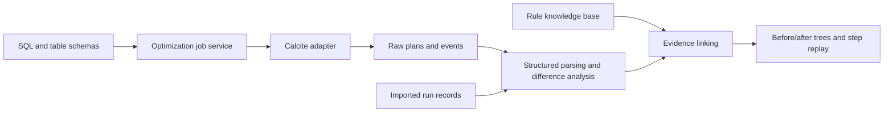

# OptiLens design and implementation plan

Status: Version 0.1 implemented; M3 in progress; M4 not started

Updated: 2026-10-22

See the [first-release implementation record](v0.1-implementation.md) for actual technology choices, validation scope, and remaining work.

## Project language

**English is required throughout the project.** Documentation, plans, user interface text, error messages, logs, code identifiers and comments, test descriptions, example explanations, commit messages, and pull request descriptions must use English. Apply the [project language policy](../README.md#project-language) to all new contributions and updates.

Language migration status:

- [x] Translate the README and all documents in `plan/` into English, including diagrams, tables, and acceptance criteria.
- [ ] Migrate existing non-English interface text, messages, logs, comments, and test/example descriptions to English, updating affected assertions as needed.

The remaining migration is separate from this documentation update; the current interface has not yet been translated.

## 1. Project goals

Build a service for researching database query optimization rules. Combine source code, plans, and runtime evidence to answer these questions:

1. Which optimizations does a specific database version implement, and under what conditions do they apply?
2. Which rules did the optimizer attempt or apply for a particular SQL query?
3. Which operators, expressions, attributes, or input relationships changed in each transformation?
4. Did a rule-generated candidate become part of the final plan?
5. How does optimization behavior differ across databases for the same example?

The primary objects of study are logical plans, relational expressions, and physical plans. A SQL AST can be a supplementary view, but not every optimization should be described as a SQL syntax-tree rewrite.

## 2. Inputs and limits of inference

| Input | Evidence it can provide | Conclusions it cannot establish on its own |
| --- | --- | --- |
| Source code and tests | Rule implementations, match patterns, applicability conditions, and test coverage | Whether a particular SQL query actually triggered a rule |
| One execution plan | Output operators, expressions, join order, and estimates | The complete intermediate transformation history |
| Two execution plans | Structural and attribute differences | Which single rule independently caused a difference |
| Optimization trace or instrumentation | Captured rule events and input/output expressions | Unrecorded rejection reasons or search steps |
| Experiments with optimization settings enabled or disabled | Plan and performance differences after a configuration change | The independent causal contribution of each internal rule |

The interface should distinguish runtime-confirmed events, observed plan differences, source-based explanations, inferences, and demonstration data. Do not display unsupported confidence percentages.

## 3. First-release scope

The first release uses Calcite as the only optimization and collection backend. Prioritize HepPlanner and explicit rule sets to provide a reproducible logical optimization workflow.

### Required features

- Accept SELECT SQL and declarative table schemas, with built-in examples to make the tool easier to use.
- Parse and validate SQL, then generate an initial logical plan.
- Optimize using the configured rule program and collect real events and plan data.
- Display the initial plan, relevant transformation steps, and final logical plan.
- Compare before/after relational expressions or plan snapshots for the selected step and highlight differences.
- Allow users to inspect expressions, inputs, outputs, and available attributes by selecting an operator.
- Display rule explanations, applicability conditions, and supporting evidence.
- Export run records that can be imported again for offline review.
- Identify the engine version, configuration, data provenance, and missing information.

### Outside the first release

- Automatically understanding every rule in an arbitrary database's source code.
- Reconstructing a complete optimization history from one EXPLAIN result.
- Query execution and performance benchmarking.
- Complete replay of a Volcano/Cascades search space.
- Live connections to multiple databases, team permissions, and hosted deployment.

First-release results describe logical optimization behavior and do not claim measured execution performance gains.

## 4. Service architecture



Separate the system into four modules with clear responsibilities:

| Module | Responsibilities |
| --- | --- |
| Job service | Input validation, job lifecycle, timeouts, result storage/retrieval, and export |
| Engine adapter | Parsing and optimization, raw event collection, and supported-capability declarations |
| Analysis layer | A shared display representation, difference calculation, and links between rules and evidence |
| Frontend | Step selection, tree and graph display, node details, and raw evidence inspection |

Source analysis is a separate future module. Initially, maintain a small set of verified rule cards manually.

### Initial technology proposals

- Backend: Java and Apache Calcite; select a service framework after technical validation.
- Frontend: TypeScript; evaluate React and libraries that support directed graph layout.
- Persistence: local run directories and JSON are sufficient for the first release; a database is not initially required.
- Dependency versions: pin versions during technical validation and record them in build configuration and run results.

These are original design proposals, not a description of completed technology choices or the current repository layout.

## 5. Calcite event collection

Use RelOptListener to observe rule attempts, expression production, equivalence relationships, and final selection events. RuleMatchVisualizer can serve as a validation tool and reference implementation. The OptiLens adapter is responsible for emitting the project's versioned data format.

Technical validation must establish:

- The order and content of HepPlanner events, including rule invocation identifiers.
- How to pair callbacks before and after a successful production without counting one transformation twice.
- The relationship between local input/output expressions and complete plans.
- Where to capture the initial plan, stage boundaries, and final plan.
- How expression sharing, wrapper nodes, and node identifiers behave across stages.

A local expression supplied by an event must not be presented as a complete global plan. When only local input/output expressions can be captured reliably, label the view as a local transformation. Display complete plans only at validated collection points.

The first release may execute selected rules in explicit stages and collect stage snapshots. It must distinguish changes across stage boundaries from individual rule events and must not present the controlled experiment as the engine's default optimization pipeline.

Snapshots must preserve values at capture time. Keeping mutable object references can overwrite historical results and must be avoided.

## 6. Core data model

### OptimizationRun: one optimization run

- Run ID, record format version, creation time, and status.
- Engine name, version, and source commit identifier when available.
- SQL, table schemas, available statistics, and optimization settings.
- Rule program, execution order, and stopping conditions.
- Initial and final snapshots, event sequence, and raw data locations.
- Collection capabilities and descriptions of missing information.

### PlanSnapshot: a plan or expression snapshot

- Snapshot ID, stage, and scope: complete plan or local expression.
- Root node, node collection, input edges, and input order.
- Native operator type and shared display type.
- Expressions, output columns, join types, and other engine attributes.
- Estimated row counts and costs, with provenance when available; leave missing values empty.
- Raw engine output.

The model must support shared nodes and directed acyclic graphs rather than only nested trees. Equivalence sets and physical properties can be added later.

### RuleEvent: a rule-related event

- Sequence number, event type, rule identifier, and invocation identifier.
- Input/output expressions, associated snapshots, and matched nodes.
- State, such as attempted, produced an expression, or discovered equivalence.
- Reasons or additional information explicitly supplied by the engine.
- Evidence provenance and references to raw records.

Do not reinterpret a missing rejection reason as proof that a rule is inapplicable. Store final-selection information separately from transformation events. If they cannot be linked reliably, the candidate's final adoption status is unknown.

### RuleCard: a rule knowledge card

- Rule name, engine, applicable version range, and conceptual category.
- Source file, symbol, and link pinned to a specific commit.
- Match pattern, applicability conditions, and semantic restrictions.
- Transformation explanation, example SQL, and related tests.
- Information sources and verification status.

Allow many-to-many relationships between optimization concepts and engine implementations. Do not assume that rules in different databases correspond one to one.

## 7. Difference analysis

Prefer reliable node identifiers and event relationships within the same run. When identifiers are unavailable, combine operator types, expressions, input structure, and column provenance to establish matches.

Display these differences:

- Added or removed nodes.
- Node movement and changes to input edges.
- Expression changes, such as constant folding.
- Changes to output columns and physical properties.

Preserve ambiguity when matching is not unique; do not force two similar subtrees to represent the same node. Normalization must preserve NULL behavior, types, ordering, join semantics, and duplicate-row semantics rather than discard them to make graphs look alike.

Comparisons across runs or databases should initially describe observed changes only. Attribution to rules requires additional event or source evidence.

## 8. Graphical interface

Use a side-by-side tree comparison as the default layout:

```text
SQL, table schemas, and run configuration
+------------------+-------------------------+-------------------------+
| Rule steps       | Plan/expression before  | Plan/expression after   |
|                  |                         |                         |
| Constant folding | Nodes and input edges   | Highlighted changes     |
| Predicate push   |                         |                         |
| Column pruning   |                         |                         |
+------------------+-------------------------+-------------------------+
| Change explanation, conditions, evidence type, details, source links |
+--------------------------------------------------------------------+
```

- Update both trees and the explanation when the selected step changes.
- Identify differences using both color and text, never color alone.
- Show complete expressions, output columns, and raw attributes when a node is selected.
- Keep corresponding nodes as stable as possible in the layout to reduce visual movement.
- Support zoom, navigation, and subtree collapsing for large plans; stack comparisons vertically on narrow screens.
- Clearly identify initial and final states, and label the scope of local events separately.
- Add equivalent-candidate graphs later to represent the search process of cost-based optimizers.

The existing interactive design mockup illustrates layout and interaction only. It is not evidence of actual rule behavior.

## 9. Implementation milestones and acceptance criteria

### M0: Validate event collection

- [x] Pin Java and Calcite versions and establish a minimal build and test entry point.
- [x] Define in-memory table schemas and implement SELECT parsing, validation, and plan generation.
- [x] Validate HepPlanner listener events and complete snapshot collection.
- [x] Export real before/after data and events for one reproducible SQL query.

Acceptance: the same example can be rerun, evidence is traceable to specific rule events, and local expressions are clearly distinguished from complete plans.

### M1: Optimization job service

- [x] Implement job submission, status queries, result retrieval, and record export.
- [x] Implement a versioned run format, raw data persistence, and import validation.
- [x] Set limits on SQL size, optimization time, event count, and graph size.
- [x] Restrict first-release input to supported query types and declarative table schemas.
- [x] Return understandable parse errors, optimization failures, and timeout states.

Acceptance: examples submitted through the service produce real results, failed jobs have explicit states, and exported records can be imported again.

### M2: Visual comparison and replay

- [x] Implement the step list, before/after plan layout, and node details.
- [x] Highlight structural and attribute differences.
- [x] Show evidence type, collection scope, version, and missing information.
- [x] Support inspection of initial and final plans.

Acceptance: selecting an event displays its associated data, differences agree with events, raw records can be inspected, and narrow-screen and keyboard interaction work.

### M3: Rule example library

- [x] Create five to ten typical examples and link them to rule cards and source code.
- [x] Cover constant folding, predicate pushdown, projection pruning, and related rule categories.
- [ ] Add boundary examples for outer joins, NULL, type conversion, and duplicate rows.
- [x] Distinguish applicability, observed transformations, absence of transformations, and unknown reasons.

Acceptance: examples have stable checkpoints, simulated data is not mixed into real run records, and rule conditions are supported by source code or tests.

### M4: A second engine and further research

- [ ] Prioritize evaluating a Spark rule-change log adapter to validate the cross-engine representation.
- [ ] Add DuckDB or PostgreSQL plan import according to engine capabilities.
- [ ] Add equivalent-candidate graphs and experiments with rule settings enabled or disabled.
- [ ] Evaluate source indexing and model-assisted rule explanations.

Acceptance: each adapter explicitly reports supported and unsupported capabilities, and plan-only inputs never produce fabricated rule histories.

## 10. Validation strategy

- Parsing and optimization: validate against real Calcite runs rather than only manually simulated events.
- Collection: verify callback pairing, snapshot independence, final states, and export/import consistency.
- Differences: cover expression changes, node movement, shared inputs, and ambiguous matching.
- Semantics: use small fixed datasets and compare results before and after optimization in tests when necessary. Such tests do not imply that the product provides a query execution service.
- Interface: verify that step selection and node details correspond to actual records, and check responsive layout.
- Version upgrades: retain verified example records and check for changes to rule behavior and record formats.

Do not require identical node identifiers or event ordering in every run. Stability checks should focus on semantics, configuration, and explainable differences.

## 11. Key risks and mitigations

| Risk | Mitigation |
| --- | --- |
| Events do not contain complete plans | Distinguish local events from stage snapshots and validate collection first |
| One setting affects multiple optimizations | Label the operation as a configuration comparison and avoid attribution to a single rule |
| Plan and source versions differ | Bind records to engine versions and pin source links to specific commits |
| Rules or search spaces become too large | Limit event and graph sizes and preserve any truncation markers |
| Cross-engine representations lose semantics | Preserve native output and attributes and adapt incrementally according to capabilities |
| Automated source explanations are incorrect | Preserve supporting evidence and verification status; do not treat model output as runtime fact |

## 12. Original questions for technical validation

1. The specific relationship between HepPlanner events and stage snapshots.
2. Exact implementation names, configurations, and applicable versions for the initial rules.
3. The frontend graph layout library and backend service framework.
4. The priority of the second engine integration.

The original plan prioritized the first two questions before expanding the interface and service, so that displayed results would be supported by real evidence. Decisions reached in the first release are recorded in the [implementation record](v0.1-implementation.md).

## 13. References

- [Calcite RuleMatchVisualizer](https://calcite.apache.org/javadocAggregate/org/apache/calcite/plan/visualizer/RuleMatchVisualizer.html)
- [Calcite RelOptListener](https://calcite.apache.org/javadocAggregate/org/apache/calcite/plan/RelOptListener.html)
- [Calcite query optimization tutorial](https://calcite.apache.org/docs/tutorial.html)
- [Spark RuleExecutor](https://github.com/apache/spark/blob/master/sql/catalyst/src/main/scala/org/apache/spark/sql/catalyst/rules/RuleExecutor.scala)
- [PostgreSQL EXPLAIN](https://www.postgresql.org/docs/current/sql-explain.html)

During implementation, verify APIs and behavior against the pinned version. Documentation for a project's main branch is not a guarantee for all versions.
